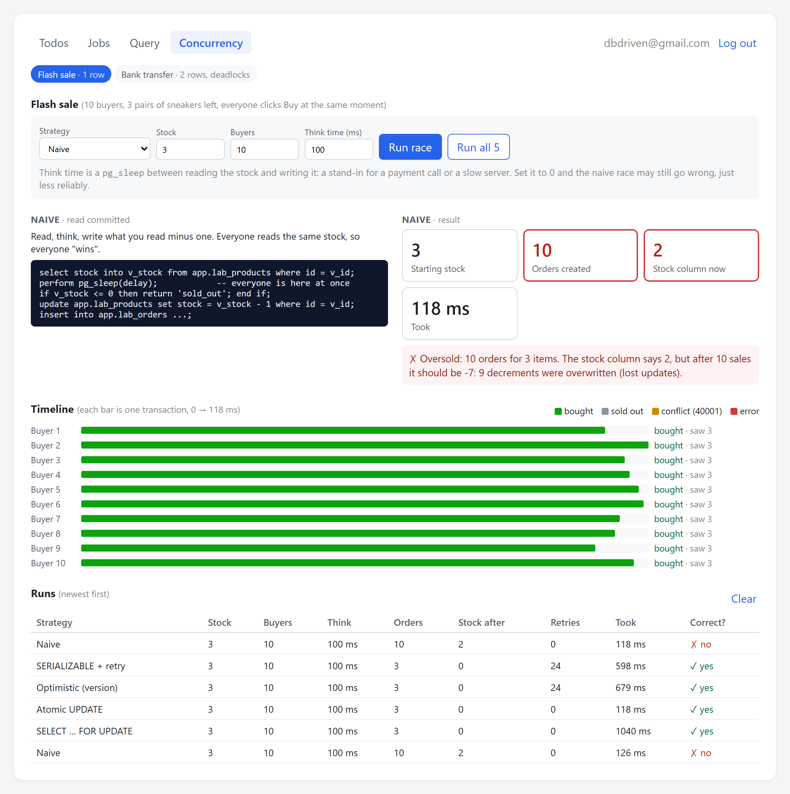
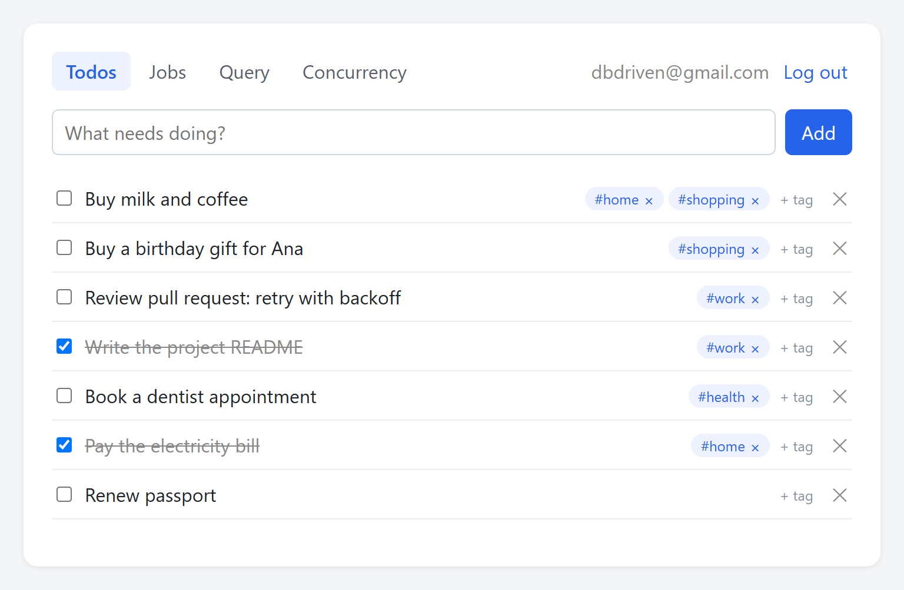
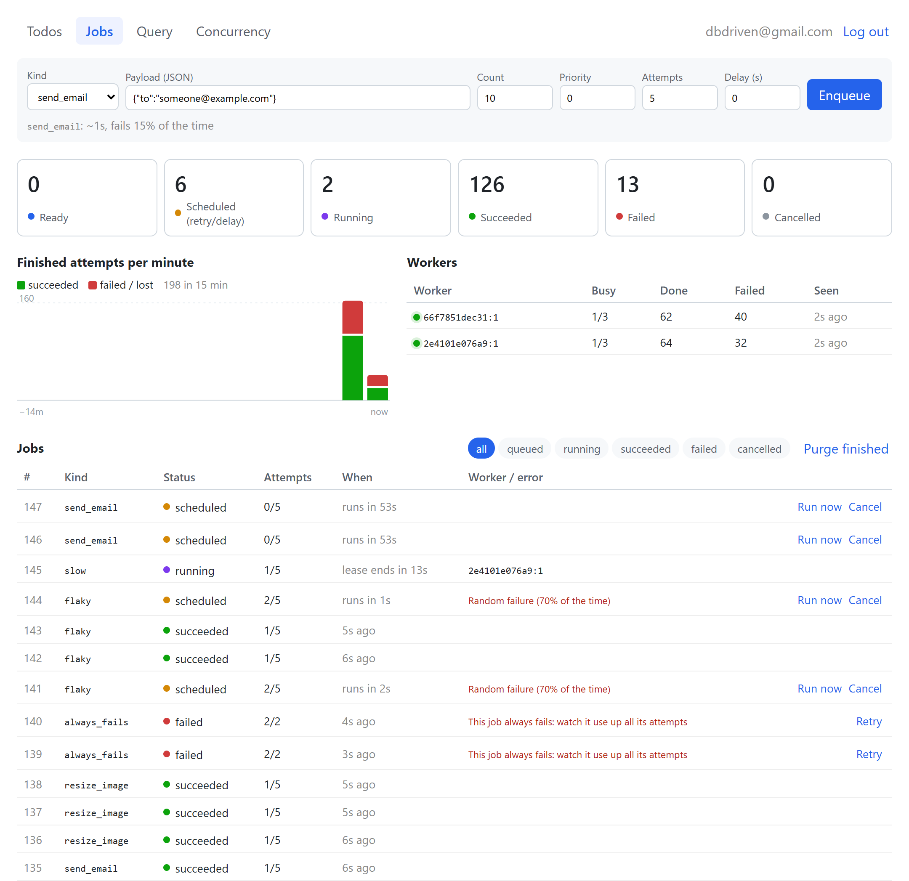
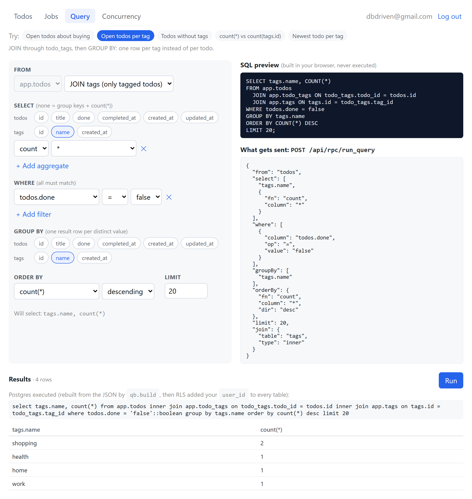
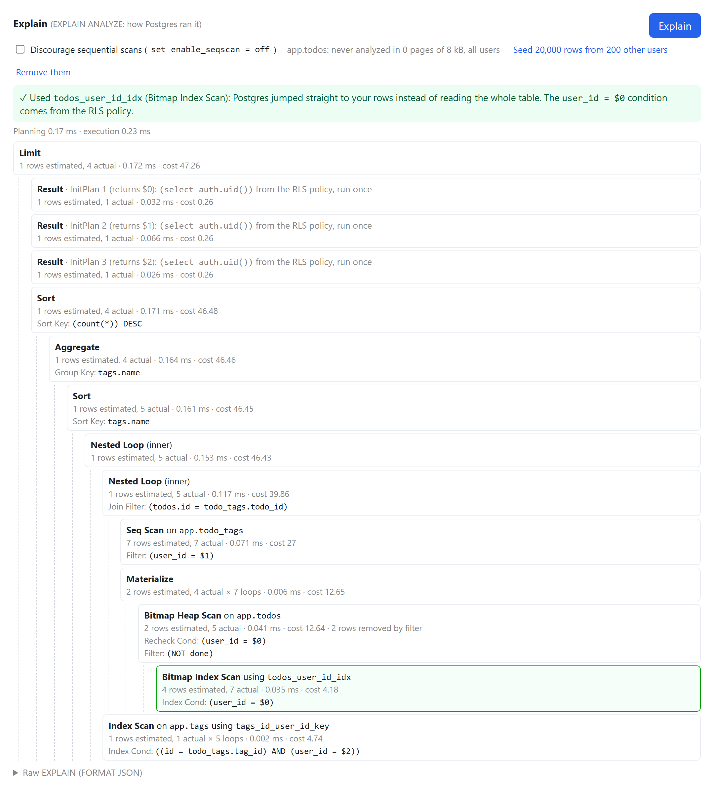
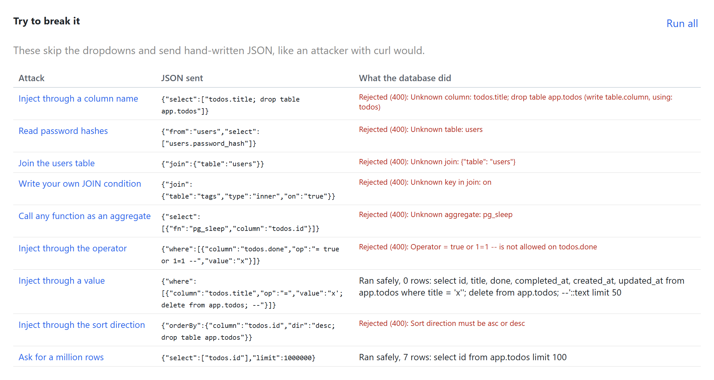
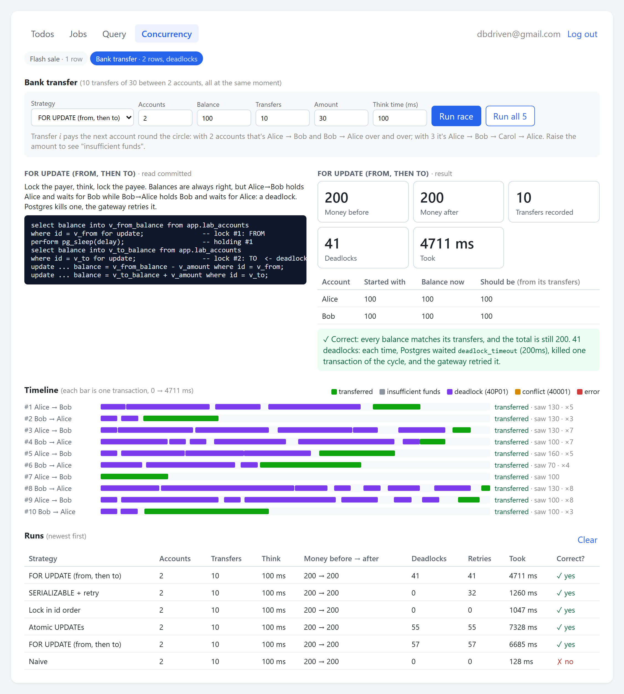

# DBDriven

**A full-stack app where PostgreSQL holds all the business logic.**

Auth, permissions, validation, business rules, realtime events, a job queue, a safe
query builder and a concurrency lab, all implemented in SQL. The backend is a ~200-line
gateway that doesn't know what a "user" or a "todo" is: it turns HTTP calls into SQL
function calls and relays notifications to the browser.




> This is a **learning project**. Every file is written to be read, and the SQL is
> commented with the *why*, not just the *what*. See
> [Limitations](#limitations-on-purpose) for what was left out on purpose.

## Contents

- [Features](#features)
- [Architecture](#architecture)
- [Getting started](#getting-started)
- [Project structure](#project-structure)
- [Todos: auth, row-level security and realtime](#todos-auth-row-level-security-and-realtime)
- [Jobs: a job queue in Postgres](#jobs-a-job-queue-in-postgres)
- [Query: a safe query builder](#query-a-safe-query-builder)
- [Concurrency Lab](#concurrency-lab)
- [Where each responsibility lives](#where-each-responsibility-lives)
- [Explore the database yourself](#explore-the-database-yourself)
- [Exercises](#exercises)
- [Limitations (on purpose)](#limitations-on-purpose)

## Features

| Tab | What it shows | Key Postgres features |
|---|---|---|
| **Todos** | Sign up, log in, todos with tags, live updates across browser tabs | JWT signed in SQL, Row Level Security, triggers, `CHECK` constraints, `LISTEN`/`NOTIFY` |
| **Jobs** | A BullMQ/Sidekiq-style job queue with retries, leases and a live dashboard | `FOR UPDATE SKIP LOCKED`, partial indexes, a trigger-based state machine |
| **Query** | A click-to-build query builder with JOINs, GROUP BY and `EXPLAIN ANALYZE` | Whitelisted dynamic SQL with `format()`, RLS on every joined table |
| **Concurrency** | 10 buyers, 3 items; opposite bank transfers; five locking strategies compared | Row locks, atomic `UPDATE`, optimistic locking, `SERIALIZABLE`, deadlock detection |

## Architecture

```
┌────────────┐  HTTP   ┌──────────────┐   SQL    ┌──────────────────────────┐
│ React      │ ──────► │ api (Node)   │ ───────► │ PostgreSQL               │
│ (web:5173) │ ◄────── │ dumb gateway │ ◄─────── │ tables, RLS, triggers,   │
│            │   SSE   │ (api:4000)   │  NOTIFY  │ JWT, functions (db:5432) │
└────────────┘         └──────────────┘          └──────────────────────────┘
                                                        ▲
                                          worker × 2 ───┘  (job queue, see below)
```

| Service | Role | Connects as |
|---|---|---|
| `db` | PostgreSQL 16. All tables, rules and API functions (`db/init/*.sql`) | — |
| `api` | Turns `POST /api/rpc/<fn>` into `select api.<fn>(<body>)`, maps SQLSTATEs to HTTP codes, relays `NOTIFY` to the browser over Server-Sent Events | `app_api`: may only call `api.*` functions |
| `worker` | Claims and runs background jobs (2 replicas) | `app_worker`: may only call `worker.*` functions |
| `web` | React + Vite dev server; proxies `/api/*` to the gateway | — |

### Life of a request: adding a todo

1. React calls `rpc("add_todo", { title: "Buy milk" }, token)` → `POST /api/rpc/add_todo`.
2. Vite's dev proxy forwards `/api/*` to the `api` container.
3. The gateway, connected as the low-privilege role `app_api`, runs:
   ```sql
   begin;
   select set_config('request.jwt', '<token>', true);   -- only for this transaction
   select api."add_todo"('{"title":"Buy milk"}'::jsonb);
   commit;
   ```
4. `api.add_todo` calls `auth.require_uid()`, which verifies the token's signature and
   expiry and returns the user id (or raises SQLSTATE `28000`, which becomes HTTP 401).
5. `insert into app.todos (title) ...` fires:
   - the column default `user_id = auth.uid()` (the client can't choose the owner)
   - the `CHECK` on title length
   - the trigger `todos_set_timestamps` (trims the title, sets timestamps)
   - the trigger `todos_enforce_open_limit` (raises an error if you already have 20 open)
   - the RLS `WITH CHECK` policy (the row must belong to you)
   - after commit, `todos_notify` publishes `{"op":"INSERT","id":..,"user_id":..}`
6. The gateway's `LISTEN` connection receives it and pushes it to that user's open
   browser tabs over Server-Sent Events, and React reloads the list.

## Getting started

**Prerequisites:** [Docker](https://www.docker.com/) with Docker Compose.

```bash
docker compose up --build
```

Open <http://localhost:5173> and sign up. Open a second tab to see realtime updates.

| URL | What |
|---|---|
| <http://localhost:5173> | The React app |
| <http://localhost:4000> | The gateway (`/api/rpc/<fn>`, `/api/rpc-batch`, `/api/events`) |
| `localhost:5432` | PostgreSQL (user `postgres`, password `postgres`, database `app`) |

The SQL in `db/init/` only runs when the database volume is **empty**. After changing
it, reset the database (this deletes all data):

```bash
docker compose down -v
```

## Project structure

```
db/init/                  everything that matters: run in order on first start
  00_setup.sql            extensions, schemas (private, auth, app, api), roles
  01_auth.sql             JWT signing/verification in SQL, auth.uid()
  02_schema.sql           tables, constraints, Row Level Security policies
  03_rules.sql            triggers: timestamps, open-todo limit, NOTIFY
  04_api.sql              the public API (api.*) and the GRANTs for app_api
  05_jobs.sql             the job queue: app.jobs, worker.* functions, reaper
  06_query_builder.sql    qb.schema() whitelist, qb.build(), run/explain
  07_concurrency.sql      Concurrency Lab: flash sale
  08_bank_transfer.sql    Concurrency Lab: bank transfers and deadlocks
api/src/server.js         the gateway: RPC, batch, SSE
worker/src/               job worker process and job handlers
web/src/                  React app: one component per tab
docs/images/              screenshots used in this README
```

## Todos: auth, row-level security and realtime



There is no auth code in the backend. Passwords are hashed with bcrypt (`crypt()` from
pgcrypto), tokens are JWTs signed and verified **in SQL** with `hmac()`, and
`auth.uid()` reads the current user from the transaction-local `request.jwt` setting.

Every table has a **Row Level Security** policy, so `select * from app.todos` only
returns *your* rows, with no `WHERE` clause. A bug in a query can't leak another user's
data. `app.users` isn't granted to the gateway's role at all: password hashes are only
reachable through `SECURITY DEFINER` functions like `api.login`.

**Tags** are many-to-many: a todo can have many tags and a tag can be on many todos, so
the links live in a third table, `app.todo_tags`:

```
app.todos ──< app.todo_tags >── app.tags
   id    ◄──── todo_id
                tag_id   ────►   id
```

`todo_tags` has **composite foreign keys**, `(todo_id, user_id) → todos (id, user_id)`
and the same for tags, so a link can only join a todo and a tag of the *same* user.
Foreign key checks ignore RLS, so with a plain `todo_id → todos (id)` you could tag
someone else's todo just by guessing its id.

**Realtime:** a trigger calls `pg_notify` after each change, the gateway `LISTEN`s on
one dedicated connection and forwards each event over Server-Sent Events to that user's
open tabs only.

## Jobs: a job queue in Postgres



A mini BullMQ / Sidekiq. The queue *is* a table (`app.jobs`); the workers are plain Node
processes (`worker/`) that log in as `app_worker`, a role that can only call the
`worker.*` functions. Everything lives in `db/init/05_jobs.sql`.

```
            api.enqueue_job                 worker.claim_jobs
React ─────► (app_api) ─────► app.jobs ◄─────────────────────── worker × 2
  ▲                             │  NOTIFY jobs_available ─────►  (app_worker)
  └──── SSE ◄── api ◄── NOTIFY job_changes                 complete_job / fail_job / heartbeat
```

| Concept | How | Where |
|---|---|---|
| Hand each job to exactly one worker | `SELECT ... FOR UPDATE SKIP LOCKED` | `worker.claim_jobs` |
| Fast "next job" query | partial index `where status = 'queued'` | `jobs_ready_idx` |
| Who owns a running job | a **lease** (`lease_expires_at`), not a long transaction | `worker.claim_jobs` |
| Long jobs stay owned | heartbeat every 5s extends the 15s lease | `worker.heartbeat` |
| Crashed worker's jobs come back | expired leases are reaped (`outcome = 'lost'`) | `private.reap_expired_jobs` |
| Retries with backoff | `run_at = now() + 2^attempt s ± 25% jitter` | `private.job_backoff` |
| Errors that retrying won't fix | `PermanentError` → straight to `failed` | `worker/src/handlers.js` |
| A slow worker can't overwrite a newer outcome | "fencing": report only if `locked_by = me` | `worker.complete_job` |
| Only legal status changes | `BEFORE UPDATE` trigger state machine | `app.jobs_check_transition` |
| Idle workers wake instantly | `NOTIFY jobs_available` (+ 1s poll fallback) | `app.jobs_notify` |
| Graceful shutdown | SIGTERM → finish, hand back the rest | `worker.unregister` |

### Why SKIP LOCKED?

Ten workers all run "give me the top 5 queued jobs" at the same instant. Without
locking, they'd all get the *same* 5. With plain `FOR UPDATE`, nine of them would wait
in line behind the first one's locks. With `SKIP LOCKED`, each one locks the first rows
nobody else holds and moves on, so they get different jobs, without waiting.

### Why at-least-once (and not exactly-once)?

A worker can finish the work (email sent!) and crash before it reports "done". The
queue can't tell this apart from "crashed before sending", so when the lease expires it
runs the job again. Jobs are never **lost**, but they can run **twice**. So handlers
must be **idempotent**: e.g. pass `job.id` as an idempotency key to the email provider.
(Exactly-once is only possible when the work and the "done" mark commit in the same
database transaction.)

### Try it

In the Jobs tab, enqueue:

- `flaky` × 10: watch attempts climb and "runs in 4s… 8s…" (backoff)
- `always_fails` with 3 attempts: ends in **failed**; click **Retry** for one more try
- `slow` (30s): outlives the 15s lease because of the heartbeat
- `crash`: kills a worker mid-job. Docker restarts it, and ~15s later the job's lease
  expires and it runs again (attempt history shows `lost`). It crashes every time, so
  it's a "poison pill" that ends in `failed` after its max attempts.
- `send_email` × 500 with 2 workers, then `docker compose up -d --scale worker=5`

```bash
docker compose logs -f worker
```

```sql
-- Watch the queue from psql (as postgres, RLS doesn't apply):
select status, count(*) from app.jobs group by 1;
select id, kind, status, attempts, locked_by, lease_expires_at - now() as lease_left
from app.jobs where status = 'running';
-- See SKIP LOCKED yourself: in two psql windows, run this in each (don't commit yet):
begin;
select id from app.jobs where status = 'queued' order by id limit 3 for update skip locked;
```

## Query: a safe query builder



The **Query** tab builds a query by clicking: pick columns, join tags, add filters
(`done = false`, `title ilike '%buy%'`), group and count, sort, limit. You see the SQL
change live, the results update as you go, and **Explain** shows how Postgres ran it.
The preset buttons at the top walk through the main ideas.

The browser **never sends SQL**. It sends a JSON description of the query (an AST), and
`qb.build` rebuilds the SQL from it inside Postgres. The gateway didn't change:
`run_query` and `explain_query` are just more RPCs.

```
React builder ── JSON AST ──► api (unchanged) ──► api.run_query / api.explain_query
  live SQL preview                                  └─ qb.build(ast)
  (display only)  ◄──── { sql, columns, rows } ────    1. check it against qb.schema()
                         or { sql, plan }               2. build SQL with format(%I, %L)
                                                    3. execute as app_api: RLS filters rows
```

```json
{ "from":    "todos",
  "join":    { "table": "tags", "type": "inner" },
  "select":  ["tags.name", { "fn": "count", "column": "*" }],
  "where":   [{ "column": "todos.done", "op": "=", "value": "false" }],
  "groupBy": ["tags.name"],
  "orderBy": { "fn": "count", "column": "*", "dir": "desc" },
  "limit":   20 }
```

| Piece | What it does | Where |
|---|---|---|
| The whitelist, as data | Tables, columns and types, operators per column, joins, aggregates. The UI's dropdowns come from it too. | `qb.schema()` |
| JSON → SQL (the real one) | Checks every name against the whitelist, builds the SQL, runs nothing | `qb.build` |
| JSON → SQL (the preview) | Pretty-prints the same AST. **Never executed.** | `web/src/queryToSql.js` |
| `%I` | Quotes an identifier: `title; drop table x` would be *one* weird name | `format()` |
| `%L` + `::type` | Quotes a value as one literal, cast to the column's type | `format()` |
| `%s` | Raw text, only for things *we* wrote: operators, types, aggregate names, join conditions from `qb.schema()` | `format()` |
| Joins by name | The client asks for `"tags"`; the `ON` conditions live in `qb.schema()` | `qb.build` |
| Unknown keys rejected | `{"join": {"table": "tags", "on": "true"}}` fails instead of being ignored | `qb.check_keys` |
| RLS + GRANTs | `SECURITY INVOKER`, so even a buggy builder only sees your rows, in every joined table; `app.users` isn't granted at all | `02_schema.sql`, `04_api.sql` |

Two independent locks: the **whitelist** decides what *shape* of query is allowed, and
**RLS + GRANTs** decide which *rows and tables* are reachable. Columns that aren't
listed (like `user_id`) can't be selected, filtered, grouped or sorted on.

Two subtle traps, both hit while building this:

- `if not v_columns ? c` lets a JSON `null` column through, because `jsonb ? NULL` is
  NULL and `if NULL` counts as false. So the checks read `if (check) is not true`.
- `args->'orderBy' - 'dir'` parses as `args -> ('orderBy' - 'dir')`, because in Postgres
  `-` binds tighter than `->`. It needs parentheses.

### JOINs and GROUP BY

| Preset | Teaches |
|---|---|
| Open todos per tag | `JOIN` through the link table, then `GROUP BY`: one row per tag, not per todo |
| Todos without tags | `LEFT JOIN` keeps todos with no match; their `tags.*` come back NULL |
| count(*) vs count(tags.id) | `count(*)` counts rows, `count(col)` skips NULLs: an untagged todo is 1 row but 0 tags |
| Newest todo per tag | `max()` inside each group |

In a grouped query every plain column must be in `GROUP BY` (what would "the title"
mean when one row stands for five todos?). `qb.build` checks this itself, so you get a
clear 400 instead of Postgres' error `42803`.

Results come back as arrays (`rows: [["home", 2]]`) next to a `columns` list, not as
objects: with a join, `todos.id` and `tags.id` are both called `id`, and in a JSON
object one would overwrite the other.

### Explain: did Postgres use the index?



**Explain** runs `EXPLAIN (ANALYZE, FORMAT JSON)` on the same SQL `qb.build` produced,
and draws the plan as a tree with estimated vs. actual rows. A few things to notice:

- The RLS policy shows up as `user_id = $0`, and `$0` comes from an `InitPlan`: that's
  `(select auth.uid())` from the policy, evaluated once per query.
- With only your own todos you'll see a **Seq Scan**. That's correct: for a table of one
  page, reading it all is cheaper than visiting an index first.
- **Seed 20,000 rows from 200 other users** (`api.seed_demo_data`) and explain again: now
  it's a **Bitmap Index Scan on `todos_user_id_idx`**. Postgres estimates `user_id = $0`
  as *rows ÷ distinct users* (20,006 ÷ 201 ≈ 99), so it's the number of *users*, not
  just the number of rows, that makes the index worth it. RLS still hides those rows
  from you; `count(*)` still says 5.
- **Discourage sequential scans** runs the query with `enable_seqscan = off`, which makes
  seq scans look absurdly expensive, so you can compare both plans' costs.
- **Remove them** deletes the demo rows, but Postgres may keep using the index for a
  minute: deleted rows stay as *dead tuples* until autovacuum runs, and the table is
  still ~230 pages for 6 live rows. Watch the page count drop, then explain again.
- RLS doesn't apply to planner statistics: the estimates reveal roughly how many rows
  *other* users have. A known side channel, and one reason not to expose `EXPLAIN` in
  production.

### Try to break it



The **Try to break it** panel sends hand-written ASTs that skip the dropdowns, the way
an attacker with curl would: injection through a column name, the operator, a value or
the sort direction, reading or joining `app.users`, writing your own `ON` condition,
calling `pg_sleep` as an "aggregate", or asking for a million rows.

```bash
# The same from a terminal (paste a token from the browser's localStorage):
curl -s localhost:4000/api/rpc/run_query -H "authorization: Bearer $TOKEN" \
  -H 'content-type: application/json' -d '{"select":["todos.password_hash"]}'
# {"error":"Unknown column: todos.password_hash","code":"22023"}
```

Ideas for later: `HAVING` (filter on an aggregate, like "tags with more than 2 open
todos"), a visual node editor (React Flow) over the same AST, and building
`qb.schema()` from `information_schema.columns`.

## Concurrency Lab

What happens when many transactions write the same rows at the same moment? The
**Concurrency** tab fires N requests at once, each in its own transaction on its own
connection, then compares what the clients were told with what the tables say. A
timeline shows every transaction as a bar: parallel bars ran together, a staircase
means they queued, and purple or orange bars were killed by Postgres and retried.

Every function has the same three steps: **read**, **think** (`pg_sleep`, standing in
for a payment call or a slow server), **write**. The strategies differ only in how they
protect the gap between read and write.

### Flash sale: 10 buyers, 3 items (one row)

See the screenshot at the top of this page: the naive strategy sold **10** pairs of the
**3** in stock, and the stock column still says 2.

| Strategy | Function | What happens with 10 buyers, 3 items |
|---|---|---|
| Naive | `api.lab_buy_naive` | All 10 read `stock = 3`, all write `2`. **10 orders**, and the stock column says **2**: an oversell *and* 9 lost updates. This is what `product.stock -= 1; save()` does in most ORMs. |
| `SELECT … FOR UPDATE` | `api.lab_buy_for_update` | The first reader locks the row and the others wait. Correct, but the timeline turns into a staircase: buyers go one at a time. |
| Atomic `UPDATE` | `api.lab_buy_atomic` | `update … set stock = stock - 1 where stock > 0`: there is no gap. A waiting `UPDATE` re-checks its `WHERE` against the committed row (a READ COMMITTED rule), so it can't oversell. Correct *and* the thinking stays parallel. |
| Optimistic (version) | `api.lab_buy_optimistic` | Think without locks, then `update … where version = <the one I read>`. 0 rows updated = someone beat you: raise `40001` and the gateway retries in a new transaction. (Why not retry inside the function? A losing `UPDATE` keeps a row lock until its transaction ends; see the comment in the SQL.) |
| `SERIALIZABLE` + retry | `api.lab_buy_naive` (!) | The **naive code, unchanged**, at `SERIALIZABLE`. Postgres aborts the losers with SQLSTATE `40001` and the gateway runs them again in a new transaction. |

**Try it:**

1. *Naive*, stock 3, 10 buyers, 100 ms: red verdict, 10 orders.
2. Set think time to 0 and run *Naive* a few times. Sometimes it's right, sometimes
   not: that's why race conditions survive testing and show up in production.
3. *Run all 5* and compare the **Took** column: `FOR UPDATE` takes about buyers × think
   time; atomic takes about one think time.
4. In psql, `begin; select * from app.lab_products for update;` and leave it open, then
   run a race. Everyone waits for you. `commit;` releases them.

### Bank transfer: deadlocks (two rows)



Alice pays Bob and Bob pays Alice, many times, all at once. A sale touched **one** row
per transaction; a transfer touches **two**, and that brings a new failure, the
**deadlock**:

```
T1 (Alice → Bob)              T2 (Bob → Alice)
lock Alice                    lock Bob
lock Bob    ← waits for T2    lock Alice  ← waits for T1      stuck forever
```

Postgres waits `deadlock_timeout`, finds the cycle, kills one transaction with SQLSTATE
`40P01`, and lets the other go on. Two checks tell you whether the database survived:
the **total** across all accounts must not change, and every account's balance must
equal what its recorded transfers say.

| Strategy | Function | What happens |
|---|---|---|
| Naive | `api.lab_transfer_naive` | Reads both balances, writes what it read ± the amount. Opposite transfers overwrite each other: the balances stop matching the transfers, and with 3+ accounts the total changes (money appears or vanishes). |
| `FOR UPDATE` (from, then to) | `api.lab_transfer_for_update` | Locks the payer, thinks, locks the payee. Always correct, but opposite directions lock in opposite orders: dozens of deadlocks and ~5× slower. |
| Atomic `UPDATE`s | `api.lab_transfer_atomic` | The flash-sale fix (`balance = balance - x`). No lost updates, but **still deadlocks**: every `UPDATE` holds its row lock until `COMMIT`, and a transfer runs two of them. |
| Lock in id order | `api.lab_transfer_ordered` | The same two locks, **lower id first**, whichever way the money goes. A queue, never a cycle: zero deadlocks, about one think time per conflicting transfer. |
| `SERIALIZABLE` + retry | `api.lab_transfer_naive` | The naive code at `SERIALIZABLE`. Postgres aborts what can't be serialized (`40001`); the gateway retries. |

Lock ordering is *the* standard fix: every code path that locks several rows agrees on
one global order. Checking for a deadlock is expensive, so Postgres only does it after
waiting `deadlock_timeout` (1 s by default). `08_bank_transfer.sql` lowers it to 200 ms
for the `app_api` role only, so a race full of deadlocks finishes in seconds, not
minutes.

**Try it:**

1. *Naive* with 3 accounts: the total changes, and the accounts table highlights the
   balances that don't match their transfers.
2. *Naive* with 2 accounts: the total still adds up (every write moves money between the
   same two rows), but the balances are wrong. A total-only check would miss it.
3. *Run all 5* with 2 accounts. Compare the **Deadlocks** and **Took** columns of
   `FOR UPDATE` and *Lock in id order*: same locks, different order.
4. Raise the amount to 80 and watch for "insufficient funds": the `CHECK (balance >= 0)`
   never fires, because every strategy checks the balance before it writes.

### What the gateway does for the lab

A few things in `api/src/server.js` exist for this tab:

- **`POST /api/rpc-batch`** runs many calls at once, one transaction each. Firing 10
  `fetch`es from the browser wouldn't make a real race: a browser opens only about 6
  connections per host over HTTP/1.1.
- **`isolation`** per call. The isolation level must be set at `BEGIN`, before any query,
  so a function can't choose it for itself.
- **A pool of 25 connections** (pg's default is 10), so a 20-buyer race isn't quietly
  queued by the pool.
- **`retry: true`** per call. `40001` (serialization failure) and `40P01` (deadlock) mean
  "the transaction was the problem, not the data: run it again". Retrying can't happen
  inside the function, because the transaction is already doomed, so the gateway re-runs
  the whole call. It waits a random, growing moment first (backoff with jitter):
  retrying instantly sends the victim back into the same lock queue, where it deadlocks
  again. The attempt number reaches SQL as the transaction-local setting
  `request.attempt`, the same way the token does. Outside a batch, the same codes map to
  HTTP 409.

## Where each responsibility lives

| Responsibility | Where | File |
|---|---|---|
| Persistence | `app.users`, `app.todos` tables | `db/init/02_schema.sql` |
| Password hashing | `crypt()` + `gen_salt('bf')` (bcrypt) from pgcrypto | `db/init/04_api.sql` |
| Tokens (JWT) | Signed/verified **in SQL** with `hmac()` | `db/init/01_auth.sql` |
| "Who is calling?" | `auth.uid()` reads the token from the `request.jwt` setting | `db/init/01_auth.sql` |
| Row permissions | Row Level Security policies | `db/init/02_schema.sql` |
| What the backend may do | `GRANT`s to the `app_api` role | `db/init/04_api.sql` |
| Validation | `CHECK` constraints | `db/init/02_schema.sql` |
| Business rules | Triggers (timestamps, max 20 open todos) | `db/init/03_rules.sql` |
| Queries / mutations | Functions in the `api` schema | `db/init/04_api.sql` |
| Realtime | Trigger → `pg_notify` → gateway `LISTEN` → SSE → browser | `03_rules.sql`, `api/src/server.js` |
| Background jobs | `app.jobs` + `SKIP LOCKED` workers, leases, retries | `db/init/05_jobs.sql`, `worker/` |
| Tags (many-to-many) | `app.tags` + `app.todo_tags`, same-owner composite FKs | `db/init/02_schema.sql` |
| User-built queries | JSON AST → whitelisted dynamic SQL, then RLS | `db/init/06_query_builder.sql` |
| Concurrent writes | Row locks, atomic `UPDATE`, version column, `SERIALIZABLE` | `db/init/07_concurrency.sql` |
| Deadlocks | Locking several rows in one global order (lowest id first) | `db/init/08_bank_transfer.sql` |

## Explore the database yourself

```bash
docker compose exec db psql -U postgres -d app
```

```sql
\dn                         -- schemas
\df api.*                   -- the public API
\dp app.todos               -- privileges
select * from app.todos;    -- as postgres (table owner): RLS is bypassed, you see everyone's

-- Pretend to be the gateway:
set role app_api;
select * from app.todos;    -- no token -> RLS shows nothing
select * from app.users;    -- permission denied: app_api has no access
select api.login('{"email":"you@example.com","password":"yourpassword"}');
-- copy the token, then:
begin;
select set_config('request.jwt', '<paste token>', true);
select api.list_todos('{}');
select * from app.todos;    -- now you see only YOUR rows
commit;
reset role;
```

## Exercises

1. Add a `priority` column with a `CHECK (priority between 1 and 3)` and expose it in `api.add_todo`.
2. Add todo sharing: an `app.todo_shares` table and a second RLS policy allowing `select` for shared users.
3. Add an `api.change_password` function (`SECURITY DEFINER`; verify the old password first).
4. Write tests for your RLS policies with [pgTAP](https://pgtap.org/).
5. Replace `db/init` with a real migration tool (dbmate or Sqitch), so you can change the
   schema without wiping data.

## Limitations (on purpose)

The following were left out to keep this a learning project:

- Hard-coded passwords in `docker-compose.yml`
- Token in the SSE query string
- No refresh tokens
- No rate limiting on login
- The Vite dev server instead of a static build
